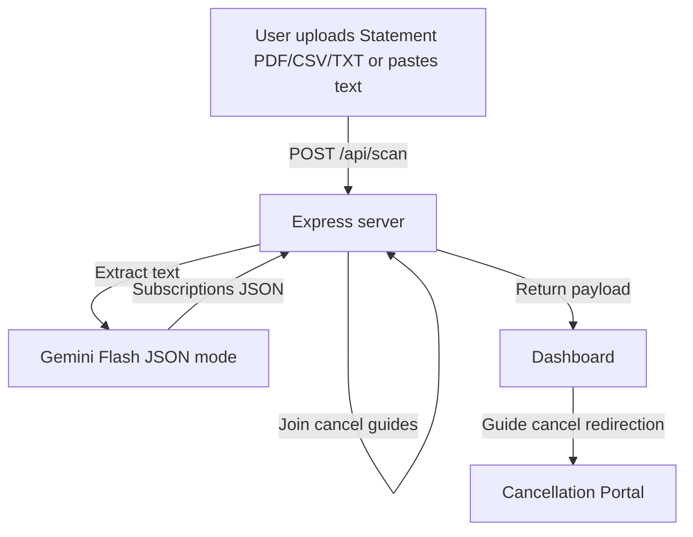

# SubSlash — AI Subscription Killer (real backend)

Scan bank statements, automatically identify recurring subscriptions with Gemini, and get step-by-step cancel guides.

## Run

```bash
npm install
npm start        # serves http://localhost:3012 (or first free 30xx port)
```

Configure AI via environment (copy `.env.example` to `.env`):

```bash
GEMINI_API_KEY=your-key-here
```

Open `http://localhost:3012` in a browser.

## API

| Endpoint        | Method | Description |
|-----------------|--------|-------------|
| `/api/health`   | GET    | `{ ok, mode: "ai" \| "keyless", ai, simulated: false }` |
| `/api/scan`     | POST   | JSON `{"text": "..."}` **or** multipart `file` (PDF/CSV/TXT, ≤5MB). Returns `{ subscriptions: [{name, amount, currency, cycle, category, confidence}], total_monthly, ai: true, simulated: false }` |
| `/api/guides`   | GET    | Cancel guides served from `guides.json` |

Errors are honest: empty input → `400`, keyless scan → `503` (nothing invented), AI failure → `502`.

## Honest capability list

- ✅ REAL: statement text extraction (PDF via `pdf-parse`, CSV/TXT direct), Gemini detection with model fallback (`gemini-3.8-flash` → `gemini-3.5-flash-lite`), strict JSON schema + server-side sanitizing, cancel guides from `guides.json` via `/api/guides`, XSS-safe rendering (`escapeHtml`, `textContent`, `http(s)`-only links).
- 🧪 DEMO ONLY: "Try sample data" button shows hardcoded subscriptions, clearly labeled, no backend needed.
- ❌ NOT real: image/screenshot statements (no OCR/vision — upload PDF/CSV/TXT or paste text), one-click cancellation (guides + links only), scan persistence (stateless — nothing is stored; add a DB if you need history).
- 🔑 Keyless mode: the UI loads and sample data works, but `/api/scan` returns `503` until `GEMINI_API_KEY` is set.

## Deploy (Vercel)

`vercel.json` routes everything to `server.js` (`@vercel/node`). Set `GEMINI_API_KEY` in the project environment variables.

---

## Technical blueprint (original)



`guides.json` holds the cancellation directory (`{ "Merchant": { "steps": [...], "link": "..." } }`) — edit it to add merchants; no client change needed.
